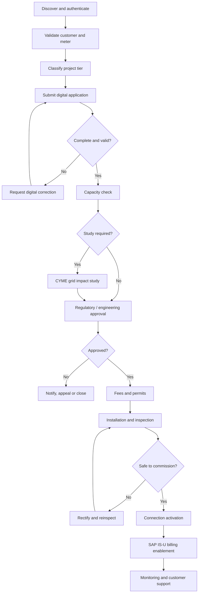

# 04 — End-to-End Paperless Journeys

[← Home](README.md) · [Next →](05-delivery-governance.md)

## Canonical lifecycle

## Journey A — Consumer application
1. Authenticate and verify account or meter reference.
2. Present eligible pathway and tier-specific guidance.
3. Prepopulate known customer information with consent.
4. Capture project capacity, location, technology and supporting evidence.
5. Validate mandatory fields and duplicate applications.
6. Issue application ID and expected next step.
7. Notify applicant of every material status change.
8. Support correction, withdrawal, appeal and resubmission.

## Journey B — Technical eligibility
1. Resolve meter/service point to feeder, transformer and substation.
2. Retrieve current connected, reserved and pending capacity.
3. Evaluate rules effective on the decision date.
4. Run engineering study when required.
5. Record result, assumptions, model version, engineer approval and validity.
6. Reserve capacity only through a controlled atomic mechanism.
7. Recalculate or release reservation after expiration or material design change.

## Journey C — Contractor and consultant
1. Register organization and professional license.
2. Validate credentials against approved registries.
3. Assign scoped access to authorized applications.
4. Upload drawings and respond to engineering clarifications.
5. Submit installation completion and inspection readiness.
6. Preserve evidence, decisions and credential audit history.

## Journey D — Inspection, commissioning and billing
1. Create field work order and inspection appointment.
2. Record field evidence, defects and safety holds.
3. Obtain authorized commissioning approval.
4. Confirm meter configuration and connection activation.
5. Send validated activation event to SAP IS-U.
6. Reconcile import/export readings, net-billing credit and invoice.
7. Surface exceptions to billing operations and service teams.

## Journey E — Customer service
1. Create inquiry or complaint in SAP C4C.
2. Link case to application ID and customer account.
3. Retrieve read-only lifecycle state from Newgen.
4. Route to correct resolver group with SLA and escalation.
5. Notify customer and close with resolution evidence.
6. Measure satisfaction and recurring failure themes.

## Four-tier journey policy
The HLDD refers to four capacity-based pathways plus an off-grid journey. Exact thresholds, mandatory studies, approvals and fees must be loaded from an approved policy matrix, not invented here.

| Dimension | Tier 1 | Tier 2 | Tier 3 | Tier 4 | Off-grid |
|---|---|---|---|---|---|
| Capacity eligibility | Policy-defined | Policy-defined | Policy-defined | Policy-defined | Policy-defined |
| Study requirement | Rules engine | Rules engine | Rules engine | Rules engine | Applicability check |
| Approval path | Configurable | Configurable | Configurable | Configurable | Separate journey |
| Fees | Effective-dated | Effective-dated | Effective-dated | Effective-dated | As applicable |
| Evidence | Tier checklist | Tier checklist | Tier checklist | Tier checklist | Off-grid checklist |

## Paperless acceptance criteria
- No unnecessary resubmission of already-verified evidence.
- Digital signatures/consent where legally recognized.
- Every action is timestamped and attributable.
- Applicant can see current status, responsible stage and next action.
- Exception and manual fallback paths are auditable.
- No commissioning without safety and billing handoff controls.
