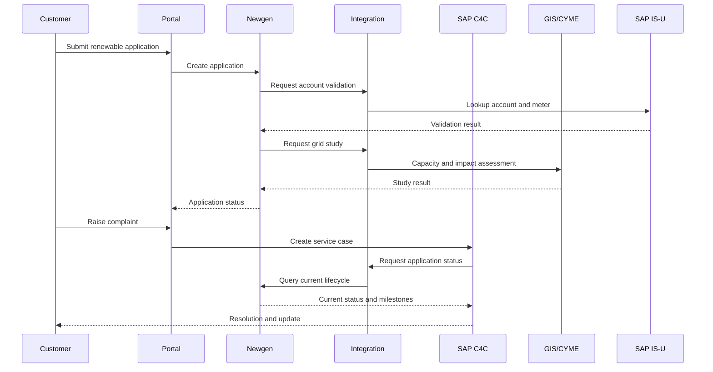

# 06 — SAP C4C vs Newgen: Architecture Decision

[← Home](README.md)

## Executive decision
**Use Newgen for application and regulatory workflow orchestration; use SAP C4C for customer service and complaint management.** They are complementary components, not interchangeable platforms. This recommendation is contingent on the deployed editions, licensing, integration feasibility, support model and total cost.

## Functional comparison
| Criterion | SAP C4C | Newgen | Preferred for this use case |
|---|---|---|---|
| Core strength | Customer relationship and service | Business process and document workflow | Role-specific |
| Customer enquiries | Native service-oriented capability | Configurable process | SAP C4C |
| Complaint handling | Case and service lifecycle | Configurable workflow | SAP C4C |
| Complex application approval | Possible with extension/integration | Core BPM orchestration use case | Newgen |
| Tier-specific process routing | Requires solution design | Rules-driven workflow | Newgen |
| Engineering study coordination | External orchestration required | Orchestrates tasks and handoffs | Newgen |
| Contractor onboarding | Service / integration pattern | Document-intensive workflow | Newgen |
| Document-heavy approvals | Attachments / integrated DMS | Document-oriented processing | Newgen |
| Customer communication | Strong service engagement | Notifications / workflow tasks | SAP C4C |
| SLA | Service case SLA | Process stage SLA | Both, distinct ownership |
| Billing system of record | Neither | Neither | SAP IS-U |
| Grid impact calculation | Neither | Neither | CYME |
| End-to-end application state | Avoid duplicate master | Recommended authoritative owner | Newgen |

## RACI-style ownership
| Business object | Create/update authority | Read/synchronize |
|---|---|---|
| Renewable application | Newgen | C4C, portal, analytics |
| Customer complaint | SAP C4C | Newgen, portal, analytics |
| Grid study | CYME / engineering | Newgen |
| Utility account | SAP IS-U | Newgen, C4C |
| Inspection work order | Field platform | Newgen |
| Invoice / credit | SAP IS-U | C4C, analytics |

## Interaction sequence

## Avoid anti-patterns
- Two independent application state machines in Newgen and C4C.
- Copying the full customer master into workflow storage without ownership rules.
- Treating Cloudera or BI dashboards as operational transaction engines.
- Embedding engineering calculations in customer service workflows.
- Sending billing activation without commissioning authorization and acknowledgement.
- Building ungoverned point-to-point interfaces.

## Decision acceptance criteria
1. One authoritative application ID and lifecycle state.
2. Service cases reference applications through a stable correlation ID.
3. Case updates cannot bypass engineering or regulatory approvals.
4. Failed integration messages can be safely replayed without duplicates.
5. Audit trail covers customer communications, decisions and status changes.
6. Security permissions are scoped by persona and customer relationship.
7. Operational support and ownership are agreed before go-live.

## Open questions
Confirm SAP C4C product generation, Newgen BPM edition, API/event capabilities, integration latency, licensing and SLA costs. Validate against an architecture proof of concept before final sign-off.
