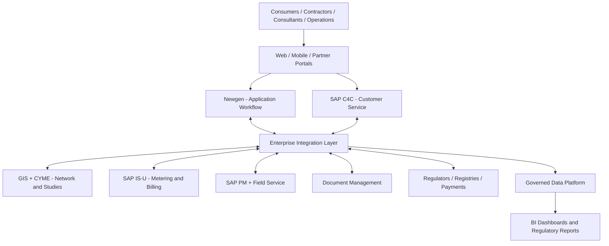

# Renewable Energy Self-Consumption — Paperless Enterprise Architecture

> Vendor-neutral client case study | Architecture knowledge base | Reference design (not a production-approved specification)

**Purpose.** A navigable, paperless solution architecture for the renewable-energy self-consumption journey, from application intake and grid impact analysis through approval, installation, commissioning, billing, monitoring and continuous improvement.

**Source basis:** An anonymized September 2026 high-level design (HLDD), reference DCS-26-UP-006. The case organization and all individual stakeholder identities are intentionally excluded. Technology product names identify architectural components, not the client.

## Wiki navigation
1. [Business context, value streams and personas](01-business-architecture.md)
2. [Application and integration architecture](02-solution-architecture.md)
3. [Data, security and non-functional architecture](03-data-security.md)
4. [End-to-end paperless journeys and decision rules](04-process-journeys.md)
5. [Delivery roadmap, governance, testing and value](05-delivery-governance.md)
6. [SAP C4C versus Newgen: architecture decision](06-c4c-vs-newgen.md)

## Core design principles
- Digital-first, no redundant paper submission; retain legally required evidence and signatures.
- One authoritative owner per data object and process state.
- Configuration-driven regulatory tiers, approvals, fees and effective dates.
- API-led integration with secure asynchronous processing where appropriate.
- Network safety, engineering validation and regulatory compliance before connection.
- Customer-visible status, auditability, privacy and accessibility by design.
- Measurable outcomes with explicit baseline and accountable business owners.

## Reference landscape

**Interpretation:** Logical conceptual architecture, not an assertion of a particular deployment topology. The detailed pages distinguish documented requirements from recommended controls and open design decisions.

## Document status
**Draft for architecture review.** Validate regulatory rule definitions, actual platform editions, API availability, security standards, technical SLAs and release dependencies before build authorization.
